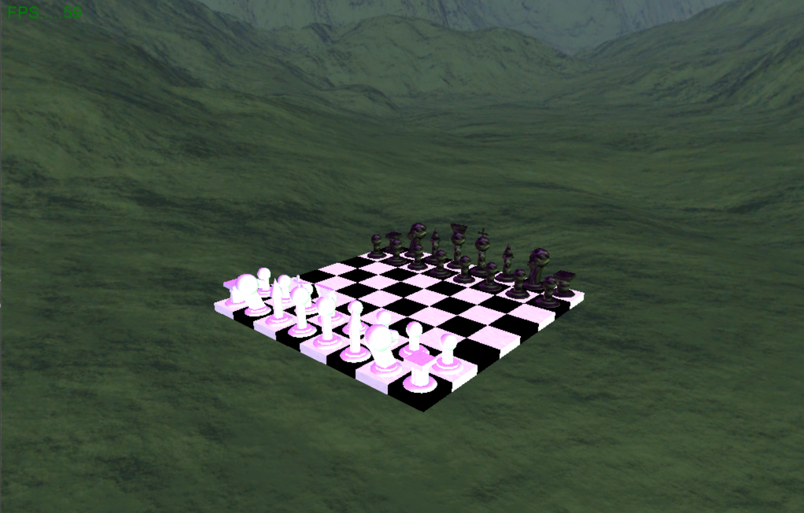

# DirectX 11 Chess Renderer

A real-time 3D chess scene written from scratch in **C++ and Direct3D 11**. A textured marble board and a full set of 32 pieces sit inside a cube-mapped mountain valley, lit by three coloured directional lights and viewed through an orbiting camera.

Every piece is **built procedurally out of primitive meshes** (cylinders, spheres, cones, tori and cubes) combined with hierarchical transforms. There are no imported 3D models.



## Technical highlights

**Rendering pipeline**
- Hand-written **HLSL vertex and pixel shaders**, compiled to `.cso` at build time and loaded at runtime
- Constant buffers split by update frequency:
  - `b0`: per-object transforms (world, view, projection, inverse-transpose world)
  - `b1`: lights (uploaded only when they change, via a dirty flag)
  - `b2`: per-piece material
- Index/vertex buffers for every primitive, sharing a single `VertexPositionNormalTexture` input layout

**Lighting and materials**
- **Blinn-Phong** shading: ambient + **three directional lights** (white, green, violet), each contributing its own diffuse and specular term. This is where the pieces get their coloured sheen.
- **Marble diffuse and specular maps** sampled per pixel, multiplied by per-material ambient / diffuse / specular colours and a specular power
- Normals transformed by the inverse-transpose world matrix, so non-uniformly scaled parts (most of the pieces) still light correctly

**Skybox**
- A cube-map texture drawn on a large cube centred on the camera
- Rendered **first**, with **front-face culling** (we're inside the cube) and a **read-only depth state**, so it never occludes the scene

**Procedural modelling**
- Each piece class (`Pawn`, `Rook`, `Knight`, `Bishop`, `Queen`, `King`) assembles 3–5 primitives with its own local scale / rotation / translation matrices
- One parent matrix per board square places and orients the whole piece, so 32 pieces are drawn from just 12 piece instances
- The board is 64 scaled cubes with alternating white and black materials

**Camera**
- Orbit camera in **spherical coordinates** (yaw, pitch, radius) around the board centre, with clamped pitch and minimum zoom distance

## Controls

| Input | Action |
|---|---|
| Click **Start** | Enter the scene |
| ← / → | Orbit around the board |
| ↑ / ↓ | Tilt the camera up / down |
| Numpad **+** / **−** | Zoom in / out |
| **Space** | Reset the camera |
| **0–4** | Change the present interval (vsync) |

## Building

**Requirements:** Windows 10/11 and Visual Studio 2022 (17.12 or later) with the **Desktop development with C++** workload.

1. Clone the repo and open `ChessRenderer.sln`.
2. Set the configuration to **Debug | x86** or **Release | x86**.
3. Press **F5**. On the first build, Visual Studio restores the [DirectX Tool Kit](https://github.com/microsoft/DirectXTK) NuGet package automatically.

The compiled shaders are written next to the executable, and textures and fonts load from `../Textures` and `../Font`. The debugger's working directory is already configured for this.

## Project structure

```
ChessRenderer/
  ChessScene.*            Scene setup, input, orbit camera, render loop
  Board.*                 8×8 board built from scaled cubes
  Pawn/Rook/Knight/
  Bishop/Queen/King.*     Procedurally modelled pieces
  LitColourShader.*       Shader wrapper: constant buffers, lights, sampler
  SkyBox.*                Cube-map skybox
  IndexedPrimitive.*      Vertex/index buffer + input layout wrapper
  Models.*                Primitive mesh generators
  Shaders/                HLSL source (lit shader + skybox)
  DirectX.*, Sprite.*, Font.*,
  TextureType.*, Timer.*  Window and Direct3D framework
Textures/                 Marble diffuse/specular maps, skybox cube map, UI panel
Font/                     SpriteFont for UI text
```

## What I'd do next

- Animate actual chess moves. Matrix interpolation helpers (`LerpMatrices`, `PingPong`) are already in `ChessScene.cpp`.
- Pull the shared piece code into a `ChessPiece` base class and use **instanced drawing**, so each piece type is a single draw call
- Add **shadow mapping** so the pieces ground themselves on the board
- Mouse-drag camera controls

## Credits

- The window / Direct3D initialisation, sprite, font, texture and timer helpers come from a starter framework provided in a graphics programming course. The primitive generators in `Models.cpp` are adapted from the [DirectX Tool Kit](https://github.com/microsoft/DirectXTK).
- Built with the [DirectX Tool Kit](https://github.com/microsoft/DirectXTK) (MIT licence).
